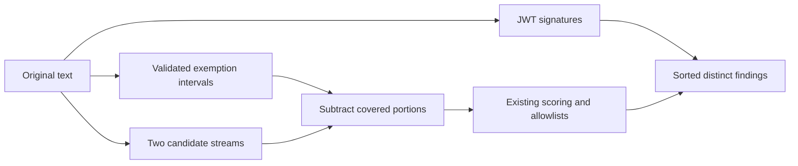

## Context

The approved scope replaces URL/path segment scoring with complete-span entropy exemptions and preserves complete numeric values. Today `findCandidateRuns` splits selected spans at `/`; the independent short-password pass still scores their contents. Path recognition also rejects `+`, `=`, and single-slash paths. Changes stay inside the entropy rule, its tests, README, and this change's OpenSpec artifacts; preset secret rules, thresholds, configuration, dependencies, and runtime integrations remain unchanged.

## Decisions

### Shared source intervals, independent scoring

Collect URL, path, and validated numeric exemptions once as source-coordinate intervals. Reuse interval subtraction for both entropy candidate streams, scoring only uncovered fragments with original offsets. Retain the existing distinct character sets: generic `[A-Za-z0-9+/=_-]`, password `[A-Za-z0-9!#$%^+~@_-]`.

Containment-only filtering is simpler but misses crossing runs; dropping every overlapping run hides outside credentials. Subtraction is the selected middle ground: URL schemes can share a generic run with an assignment prefix because `+`, `-`, and `=` are candidate characters; `~` can similarly join password candidates across a path start. Only validated exemption boundaries split these crossing runs. Unaffected runs retain existing tokenization and scoring; no global punctuation retokenization is introduced. Existing JWT and anchored allowlist handling remains separate from this targeted operation.

### Bounded URL/path recognition

Use the existing scheme-shaped `://` recognition and anchored path recognizers, with a shared terminator set: whitespace, quotes, backticks, and round/square/curly/angle brackets. Retain commas and semicolons inside spans because both can be literal URL/path characters; delimiter-free adjacency is not guessed to be a separate credential. Outside credentials separated by the stated boundaries remain independently scored.

Recognize POSIX `/single` and multisegment paths; `./`, `../`, `~/`; drive-letter paths using either slash; UNC paths; and native backslash relative anchors. Path starts retain start-of-text or existing boundary anchoring, avoiding arbitrary slash-containing credential suffixes. Remove the plus/equals and two-slash discard filters: neither distinguishes valid paths under the approved scope. Reject a filesystem parser or dependency: lexical spans suffice for displayed text and avoid platform-dependent interpretation.

### Complete numeric context

Recognize optional signs, integer/decimal mantissas (including leading/trailing decimal points), and optional signed scientific exponents. Validate the entire value against numeric grammar, not individual candidate fragments: periods split both charsets, while exponent letters and signs can remain inside them. Recognize standalone/delimited values and numeric assignment values after an identifier plus `=` or `:`; keep the assignment prefix outside the exempt interval. Reject numeric prefixes/suffixes inside identifiers, malformed numbers, and credential-like mixed tokens before creating any interval. This avoids exempting digit fragments merely because punctuation split a credential. Run-local numeric checks were rejected because decimal/scientific fragments lack that context.

### Preserve pattern detection

JWT recognition runs on original text and emits nonempty signature findings before entropy exclusions, including inside URLs/paths. Preset rules continue scanning original content independently. No generic rule-wide allowlist or redaction-pipeline change is introduced.

## Risks

Opaque secrets inside exempt spans intentionally lose entropy detection; explicit patterns and JWT signatures remain active. Lexical punctuation is ambiguous, especially unspaced comma/semicolon adjacency. Recognition remains message-local with no persistence or recovery state; rollback restores prior scoring without data migration. Interval handling adds work proportional to spans and candidates; an interval index is unnecessary without measured pressure.
